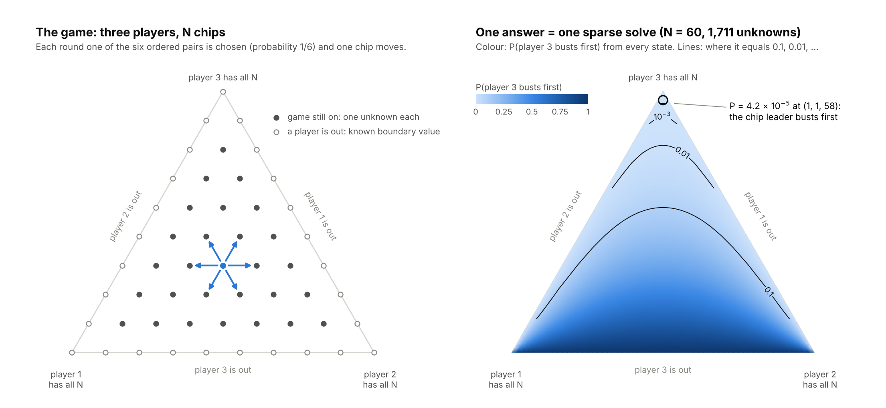
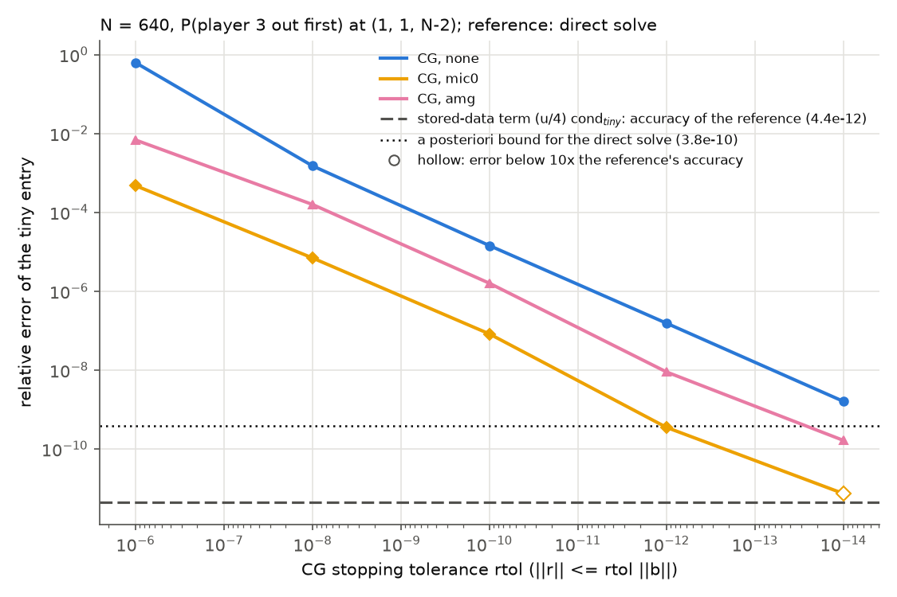
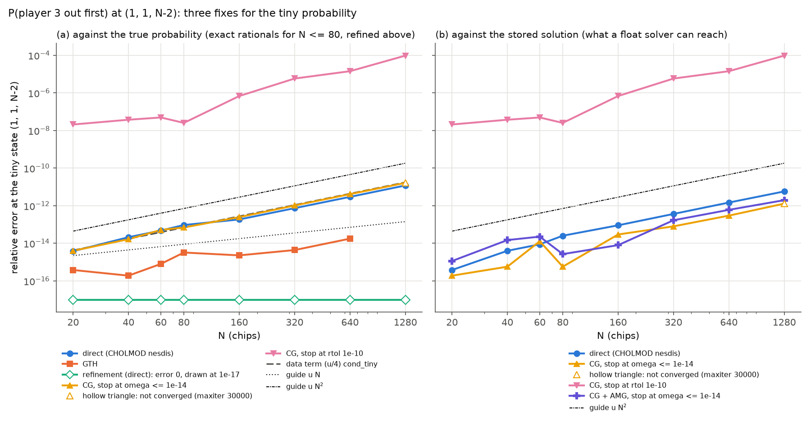

# Gambler's ruin as a sparse linear system

**Can a sparse solver get a probability of 4 × 10⁻⁹ right to every digit?** This project answers that for the
three-player gambler's ruin, a poker-tournament model, where every probability is one solve with a sparse
symmetric positive definite matrix whose eigenvalues are known exactly.

Math 221 (Advanced Matrix Computations), UC Berkeley, Fall 2026. Neel Dankar and David Heli Collin.



## The game

Three players hold x1 + x2 + x3 = N chips. Each round one of the six ordered pairs (a, b) is picked at random
and player a takes one chip from player b. A player with no chips is out, and the other two play on until one
holds everything. This is the model Diaconis and Ethier use to test the Independent Chip Model (ICM) that poker
players use to value chip stacks.

Every question about the game (who busts first, who finishes second, the full finishing order, how long it lasts)
is a linear system A x = b:

- one unknown per state still in play, n = (N-1)(N-2)/2 of them (817,281 at N = 1280; the largest run has
  5.1 million);
- A = I - Q, where Q holds the move probabilities 1/6: a 7-point Laplacian on a triangle, symmetric positive
  definite, an M-matrix, at most 7 nonzeros per row;
- b collects the known values on the boundary, where a player is out.

The running example is the **tiny entry**: the probability that the chip leader busts first from (1, 1, N-2).
It is about 9.12 / N³, so 4.2 × 10⁻⁵ at N = 60 (the circle in the figure) and 4.3 × 10⁻⁹ at N = 1280.

## Main results

1. **Tiny probabilities are not ill-conditioned.** The componentwise condition number of entry i is exactly
   2 E[T | event], twice the expected game length given the event: 0.39 N² at the tiny entry, with no 1/x penalty.
2. **CG with the usual stopping test gets them wrong anyway.** Stopping at ‖r‖ ≤ rtol ‖b‖ bounds the absolute
   error, not the relative one: at N = 640 the tiny entry is off by 63% at rtol 10⁻⁶ and by 1.4 × 10⁻⁵ at
   rtol 10⁻¹⁰, while the normwise error looks fine (1.6 × 10⁻⁹). At N = 1280 CG returns a negative probability.
3. **Even exact solvers carry three separate errors at a tiny entry:** the stopping rule, the rounding of 1/6 when
   the matrix is stored (which moves entry i by exactly E[(1+d)^T; event] - P(event), d = -2⁻⁵⁴, about
   -0.097 N² u at the tiny entry), and the solver's own arithmetic (a fraction of the condition number times u that depends on the
   algorithm, the ordering and the machine).
4. **Three fixes work.** Iterative refinement with an exact integer residual puts every entry within half an ulp
   of the true probability, checked up to N = 1280. GTH elimination (no subtractions) stays below 0.42 N u.
   Stopping CG on the componentwise backward error makes it as accurate as a direct solve.
5. **SOR obeys a cubic, not Young's quadratic.** The matrix is not consistently ordered, so Young's theory does not
   apply, yet Young's ω* is still optimal and the best spectral radius is exactly (ω* - 1)^(3/4). Proof in
   [`notes/proofs.md`](notes/proofs.md), section 10.



*The usual stopping test against the error of the tiny entry at N = 640. The dashed line is where every solver of
the stored matrix bottoms out: the rounding of 1/6.*



*Left: error against the true probability. Refinement (green) is correct to half an ulp at every N; GTH (red)
stays below 0.42 N u; the direct solve and componentwise-stopped CG follow the dashed data term. Right: error
against the exact solution of the stored matrix, which is all a float solver can reach.*

## Everything else in the project

| Topic | Result | Where |
| --- | --- | --- |
| Exact spectrum | λ_kl = 1 - ⅓[cos(2π(2k+l)/3N) + cos(2π(k+2l)/3N) + cos(2π(k-l)/3N)] (Prager 2001); κ₂ → 9N²/(8π²) | `c01`, `f01` |
| Direct solvers | Natural-order fill is exactly n + (N-3) + (N-1)(N-2)(N-3)/3; nested dissection reaches N = 3200 (5.1 million unknowns) in 56 s | `c02`, `f02` |
| Krylov solvers | CG ≈ 1.9N iterations, MIC(0) grows like √N (158 at N = 1280), AMG 7 to 21 at every size; CG on b = 1 stops after exactly ⌊(N-1)/2⌋ steps | `c03`, `f03` |
| Stationary methods | Jacobi and Gauss-Seidel need O(N²) sweeps, SOR(ω*) about 3.2N; the cubic and the 3/4 law | `c05`, `f05` |
| FFT solver | Exact O(n log n) solver by the method of images (18 reflections): N = 1600 in 1.3 s, but only normwise accurate | `c06`, `f06` |
| Which condition number? | Entrywise 0.39N², structured (model parameters) 1.22N, symmetric about log N, random rms about 1 | `c07b`, `f07_structured` |
| Poker application | First place is exact in the ICM, so every equity error is a second-place error; the largest is 0.036, and short stacks are overrated at every state we checked | `c08`, `f08` |
| Four players | 3D grid: 11× the fill and 127× the flops at equal size; tiny probability decays like N^-5.720688 (from a cone eigenvalue) | `c09`, `f09` |
| Least squares | Diaconis and Ethier's sextic regression redone: cond(X) = 1.7 × 10⁷, the normal equations lose 4 extra digits, the fit does not | `c10`, `f10` |
| Unequal skill | A symmetrized Bradley-Terry chain where CG converges but is 100% wrong where the stationary weights are tiny | `c10`, `f10` |

`cNN` is the spec in [`plan/`](plan), `fNN` the figure in [`figures/`](figures).

## Quick start

```bash
git clone https://github.com/neeldankar/gamblers-ruin-221
cd gamblers-ruin-221
conda env create -f environment.yml        # Python 3.13, numpy, scipy, pyamg, numba, scikit-sparse, python-flint
conda activate gr221
pytest -q                                  # 521 passed, 43 skipped (opt-in pipeline tests), about 30 s
```

Solve for every finishing-order probability at N = 100:

```python
from gr.states import StateSpace
from gr.matrix import build_A, rhs_out_first, solve

S = StateSpace(100)
x = solve(build_A(S), rhs_out_first(S, 2))   # P(player 3 busts first) from every state
print(x[S.index((1, 1, 98))])                # the tiny entry, about 9.12 / 100**3
```

Reproduce the results:

```bash
PYTHONPATH=. python experiments/e07_fixes.py --quick --outdir /tmp/try   # one experiment, small sizes
python experiments/run_all.py --quick                                    # all 21 experiments, about a minute
python experiments/run_all.py                                            # full run into results/ (1.4 h on a 16 GB Mac)
python figures/make_all.py                                               # 20 figures from the CSVs
python checks/check_all.py                                               # every check, one report
```

The final results are commit `4ceaac1` (code `5a73f57`): 21 experiments, 34 CSVs, 0 failed checks. Timings and
peak memory are from one Apple Silicon Mac; everything else (counts, fill, probabilities, errors) is deterministic.

## Repository layout

| Folder | Contents |
| --- | --- |
| [`gr/`](gr) | The library: state spaces and matrices, exact rational solves, the spectrum, direct, Krylov and stationary solvers, the FFT solver, condition numbers, refinement and GTH, the ICM, four players |
| [`experiments/`](experiments) | One script per experiment, each writing `results/eNN_*.csv`; `run_all.py` runs them all |
| [`results/`](results) | The CSVs, one check report per chunk (`cNN_report.md`), and [`final_report.md`](results/final_report.md) |
| [`figures/`](figures) | One script per figure, reading only the CSVs, and the PNGs |
| [`checks/`](checks) | Turns each spec's expected-results table into PASS / WARN / FAIL lines |
| [`tests/`](tests) | Acceptance tests, written and validated before each part was built |
| [`plan/`](plan) | The spec of every part: goal, method, expected results with tolerances |
| [`notes/`](notes) | [`proofs.md`](notes/proofs.md) (every derivation) and [`decisions.md`](notes/decisions.md) (the decision log) |
| [`docs/`](docs) | The README figure and the script that draws it |

## How it was checked

The project was built in 15 parts. Each has a written spec with expected values, tests written and validated
before the code, and a check script. Headline numbers were recomputed with separate code (exact rational solves
for small N, and an exact integer residual that measures the error of any float vector to about 10 digits, up to
N = 1280). Three outside reviews, the last covering everything, checked the claims; their corrections are in the specs
and the decision log. AI tools were used throughout, as the course allows: Claude Code wrote the code from our specs, and every
claim was checked independently.

## Prior work

The model, the ICM comparison, the sextic regression, the four-player estimate 5.72 and the conjectured N⁻⁴
convergence are from P. Diaconis and S. N. Ethier,
[*Gambler's ruin and the ICM*](https://arxiv.org/abs/2011.07610), Statistical Science 37 (2022). The constant
Γ(1/3)⁹/(8π⁴) is due to Sangchul Lee (in that paper), and D. Denisov and V. Wachtel,
[*Harmonic measure in a multidimensional gambler's problem*](https://arxiv.org/abs/2212.11526), Ann. Appl.
Probab. 34 (2024), proved the asymptotics. The four-player exponent is from J. O'Connor and L. Saloff-Coste,
[*The 4-player gambler's ruin problem*](https://arxiv.org/abs/2209.05264) (2022). The numerical methods (componentwise
error analysis, GTH, compensated dot products, nested dissection, MIC(0), AMG) are standard and cited in
[`notes/proofs.md`](notes/proofs.md) and the specs.
